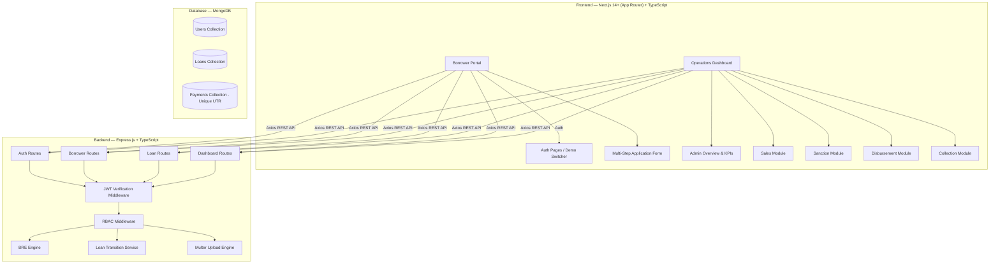
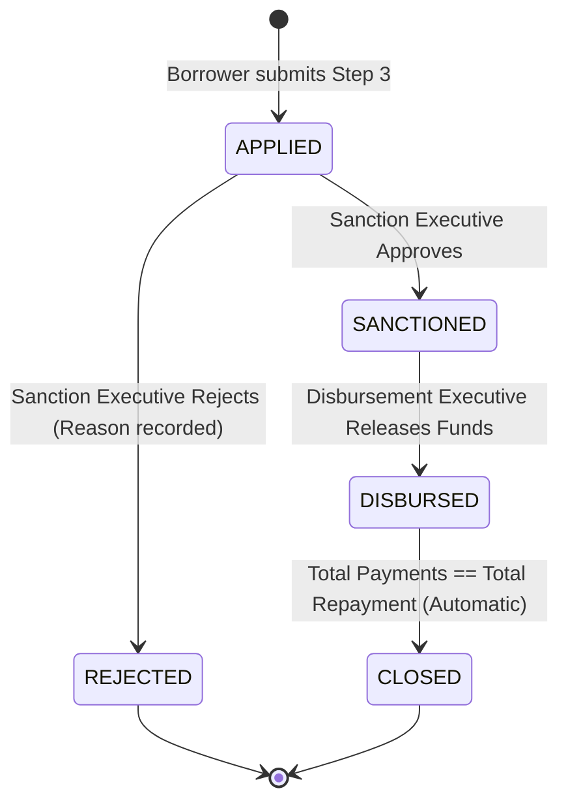

# 🏦 CreditSea — Loan Management System (LMS)

[](https://www.typescriptlang.org/)
[](https://nextjs.org/)
[](https://nodejs.org/)
[](https://expressjs.com/)
[](https://www.mongodb.com/)
[](https://docs.google.com/videos/d/1SLzyEydcodb_l0wSp4ivBgg6ZOw3ymqJ3hjF0ZlSOHQ/play?usp=sharing)

A modern, production-grade lending platform where borrowers apply for personal loans through a guided multi-step journey with instant Business Rule Engine (BRE) eligibility feedback, and internal executives manage the loan lifecycle across Sales, Sanction, Disbursement, and Collection through role-based operations dashboards.

---

### 🌐 Live Production Links & Video Demo

- 🎥 **Live Video Walkthrough (End-to-End Demo)**: [Watch on Google Drive](https://docs.google.com/videos/d/1SLzyEydcodb_l0wSp4ivBgg6ZOw3ymqJ3hjF0ZlSOHQ/play?usp=sharing)
- 🚀 **Live Application (Frontend)**: [https://credit-loan-management-system.vercel.app/](https://credit-loan-management-system.vercel.app/)
- ⚡ **Live API Service (Render)**: [https://creditsea-server-eq85.onrender.com/api/health](https://creditsea-server-eq85.onrender.com/api/health)
- 🗄️ **Cloud Database**: MongoDB Atlas (Connected & Seeded)
- 📂 **GitHub Repository**: [mayank123hangsh00/Credit-Loan-Management-system](https://github.com/mayank123hangsh00/Credit-Loan-Management-system)

---

## 📑 Table of Contents

- [Key Features](#-key-features)
- [Architecture & Tech Stack](#-architecture--tech-stack)
- [Loan Status Lifecycle](#-loan-status-lifecycle)
- [Business Rule Engine (BRE)](#-business-rule-engine-bre)
- [Pre-Seeded Demo Credentials](#-pre-seeded-demo-credentials)
- [Project Structure](#-project-structure)
- [Getting Started](#-getting-started)
- [API Reference](#-api-reference)

---

## ✨ Key Features

### 👤 Borrower Journey
1. **Secure Authentication**: Sign up and login with bcrypt-hashed credentials and JWT tokens.
2. **Step 1 — Personal Details & Live BRE**: Form collecting Full Name, PAN, DOB, Monthly Salary, and Employment Mode with real-time client-side eligibility validation and server-side authoritative check.
3. **Step 2 — Document Upload**: Drag-and-drop salary slip uploader (PDF/JPG/PNG, up to 5 MB) backed by Multer.
4. **Step 3 — Interactive Loan Configuration**: Interactive sliders for Loan Amount (₹50,000 – ₹5,00,000) and Tenure (30 – 365 days) with real-time Simple Interest ($SI = \frac{P \times R \times T}{365 \times 100}$) and Total Repayment calculation.
5. **My Loans Dashboard**: Real-time tracking of all submitted applications, approval/disbursement status, rejection reasons, and repayment balances.

### 🛡️ Operations Dashboard (Role-Based Access Control)
- **Admin Console**: Executive portfolio metrics, loan lifecycle distribution (Applied, Sanctioned, Disbursed, Closed, Rejected), total disbursed capital, and unrestricted cross-module access.
- **Sales Module**: Lead pipeline tracking registered borrowers who haven't submitted a loan application yet, detailing application step and BRE eligibility.
- **Sanction Module**: Credit review queue for pending `APPLIED` loans with borrower dossier inspection (salary slip view, income details), one-click Approval (`SANCTIONED`), or Rejection (`REJECTED`) with mandatory justification.
- **Disbursement Module**: Operational desk for approved `SANCTIONED` loans to execute fund disbursement, transitioning them to `DISBURSED`.
- **Collection Module**: Portfolio monitoring for `DISBURSED` loans with outstanding balances, payment recording modal (UTR tracking with MongoDB unique indexing, payment date, and amount validation), real-time progress bars, and automatic transition to `CLOSED` upon complete settlement.

---

## 🏗️ Architecture & Tech Stack



- **Frontend**: Next.js 14+ (App Router), React 19, TypeScript, Vanilla CSS Design System with dark glassmorphic styling, Tailwind CSS utility layer.
- **Backend**: Node.js, Express.js, TypeScript, Mongoose, Multer, bcryptjs, jsonwebtoken, cors.
- **Database**: MongoDB (Mongoose schemas with indexes for unique emails and UTR numbers).

---

## 🔄 Loan Status Lifecycle



---

## ⚖️ Business Rule Engine (BRE)

The system enforces 4 key eligibility rules evaluated **client-side** for instant UX feedback and **server-side** as an authoritative gate:

| Rule | Criterion | Failure Condition |
|---|---|---|
| **Age Eligibility** | 23 to 50 years old | Calculated dynamically from Date of Birth |
| **Minimum Salary** | Minimum ₹25,000 / month | Monthly salary < 25,000 |
| **PAN Format** | Standard Indian PAN regex | Does not match `/^[A-Z]{5}[0-9]{4}[A-Z]{1}$/` |
| **Employment** | Active Employment | Applicant is `unemployed` |

---

## 🔑 Pre-Seeded Demo Credentials

The database seed script (`npm run seed`) populates one dedicated account for each role:

| Role | Email | Password | Access Scope |
|---|---|---|---|
| **Admin** | `admin@creditsea.com` | `Admin@123` | Full access to Overview, Sales, Sanction, Disbursement & Collection |
| **Sales** | `sales@creditsea.com` | `Sales@123` | Lead pipeline tracking |
| **Sanction** | `sanction@creditsea.com` | `Sanction@123` | Credit underwriting & approval/rejection |
| **Disbursement** | `disbursement@creditsea.com` | `Disbursement@123` | Fund release desk |
| **Collection** | `collection@creditsea.com` | `Collection@123` | Repayment recording & closure tracking |
| **Borrower** | `borrower@creditsea.com` | `Borrower@123` | Multi-step loan application & borrower dashboard |

> 💡 *Quick Tip*: The login page includes 1-click credential auto-fill buttons for testing any role instantly!

---

## 📁 Project Structure

```
Creditsea/
├── client/                     # Next.js 14 Frontend
│   ├── src/
│   │   ├── app/
│   │   │   ├── (borrower)/     # Borrower routes (/apply, /my-loans)
│   │   │   ├── (dashboard)/    # Operations dashboard (/sales, /sanction, /disbursement, /collection, /overview)
│   │   │   ├── login/          # Login page with demo role filler
│   │   │   ├── register/       # Registration page with strength meter
│   │   │   ├── globals.css     # Premium dark design tokens & glassmorphism
│   │   │   └── layout.tsx      # Root layout + AuthProvider
│   │   ├── lib/                # Axios instance, Auth context, BRE rules, Loan calculation
│   │   └── types/              # TypeScript interfaces
│   └── package.json
│
├── server/                     # Express.js + TypeScript Backend
│   ├── src/
│   │   ├── config/             # DB & env configuration
│   │   ├── controllers/        # Auth, Borrower, Loan, Dashboard controllers
│   │   ├── middleware/         # JWT auth, RBAC authorization, Multer upload
│   │   ├── models/             # Mongoose models: User, Loan, Payment
│   │   ├── routes/             # REST endpoints
│   │   ├── scripts/seed.ts     # Demo database seeder
│   │   ├── services/           # BRE service & interest calculators
│   │   └── app.ts              # Express initialization
│   ├── uploads/                # Static salary slip storage
│   └── package.json
│
├── package.json                # Root scripts (concurrently dev, build, seed)
└── README.md
```

---

## 🚀 Getting Started

### 1. Prerequisites
- **Node.js** (v18.0 or higher)
- **MongoDB** running locally (`mongodb://localhost:27017`) or a MongoDB Atlas connection string.

### 2. Installation
Install all dependencies across root, client, and server:
```bash
npm run install:all
```
*(or manually run `npm install` inside both `./client` and `./server`)*

### 3. Environment Variables
Server configuration (`server/.env`):
```env
PORT=5000
MONGODB_URI=mongodb://localhost:27017/creditsea
JWT_SECRET=creditsea-super-secret-jwt-key-change-in-production
JWT_EXPIRES_IN=7d
UPLOAD_DIR=./uploads
NODE_ENV=development
```

Client configuration (`client/.env.local`):
```env
NEXT_PUBLIC_API_URL=http://localhost:5000/api
```

### 4. Seed the Database
Populate all test roles and initial demo data:
```bash
npm run seed
```

### 5. Start Development Servers
Run both frontend and backend concurrently with a single command:
```bash
npm run dev
```

- **Frontend**: http://localhost:3000
- **Backend API**: http://localhost:5000/api

---

## 📡 API Reference

### Authentication (`/api/auth`)
| Method | Endpoint | Access | Description |
|---|---|---|---|
| `POST` | `/api/auth/register` | Public | Register new user (defaults to `borrower`) |
| `POST` | `/api/auth/login` | Public | Authenticate user & return JWT token |
| `GET` | `/api/auth/me` | Authenticated | Retrieve current user profile |

### Borrower Operations (`/api/borrower`)
| Method | Endpoint | Access | Description |
|---|---|---|---|
| `PUT` | `/api/borrower/details` | Borrower | Submit personal info & run authoritative server BRE |
| `POST` | `/api/borrower/salary-slip` | Borrower | Upload salary slip (multipart/form-data) |
| `GET` | `/api/borrower/status` | Borrower | Retrieve application step & BRE validation status |

### Loan Operations (`/api/loans`)
| Method | Endpoint | Access | Description |
|---|---|---|---|
| `POST` | `/api/loans/apply` | Borrower | Submit loan application with amount & tenure |
| `GET` | `/api/loans/my-loans` | Borrower | List borrower's loan portfolio |
| `GET` | `/api/loans/:id` | Authenticated | Fetch specific loan details |

### Dashboard & Operations (`/api/dashboard`)
| Method | Endpoint | Access | Description |
|---|---|---|---|
| `GET` | `/api/dashboard/stats` | Admin | Aggregate portfolio statistics & lifecycle counts |
| `GET` | `/api/dashboard/sales/leads` | Sales, Admin | Borrowers registered without loan applications |
| `GET` | `/api/dashboard/sanction/loans` | Sanction, Admin | Pending `APPLIED` loans for credit assessment |
| `PUT` | `/api/dashboard/sanction/:id/approve` | Sanction, Admin | Transition loan to `SANCTIONED` |
| `PUT` | `/api/dashboard/sanction/:id/reject` | Sanction, Admin | Transition loan to `REJECTED` with reason |
| `GET` | `/api/dashboard/disbursement/loans` | Disbursement, Admin | Approved `SANCTIONED` loans ready for payout |
| `PUT` | `/api/dashboard/disbursement/:id/disburse` | Disbursement, Admin | Transition loan to `DISBURSED` |
| `GET` | `/api/dashboard/collection/loans` | Collection, Admin | Active `DISBURSED` loans with outstanding balances |
| `POST` | `/api/dashboard/collection/:id/payment` | Collection, Admin | Record EMI payment with UTR & auto-close check |
| `GET` | `/api/dashboard/collection/:id/payments` | Collection, Admin | Payment transaction history for loan |
